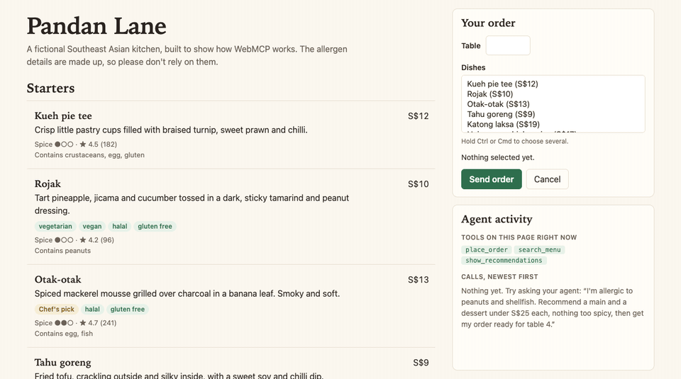

# webmcp-menu

A small, readable example of [WebMCP](https://webmachinelearning.github.io/webmcp/): a web page that gives an AI agent real tools to call, instead of leaving it to scrape the screen.

The page is the menu of Pandan Lane, a fictional restaurant. Ask an agent for dinner and it searches the menu, highlights its picks with reasons, and fills in your order. Only you can send that order.



*A replay of the tool calls `gemini-3.5-flash-lite` made in a real run, sent through `getTools()` and `executeTool()`, the same calls the Inspector extension makes. The extension's own panel isn't in the recording, and a script pressed Send order.*

## The idea

Each side does the part it's good at:

- **The page applies the facts.** Allergens, diets, prices and sold-out dishes are plain code, so an allergen answer never depends on a model's guess.
- **The agent judges taste.** It reads the results and chooses using what the diner told it.
- **The diner decides.** The agent can prepare an order, but only a person can send it.

Unlike a server-side MCP tool, WebMCP tools run inside the page the person is looking at, so the agent's actions show up on their screen.

## Try it

You need Chrome 156 or later (it was only tested on 156), Node 22 or later, and a [Gemini API key](https://aistudio.google.com/apikey). There's nothing to install from npm.

1. Open `chrome://flags/#enable-webmcp-testing`, enable it and relaunch Chrome.
2. Install the [Model Context Tool Inspector](https://chromewebstore.google.com/detail/model-context-tool-inspec/gbpdfapgefenggkahomfgkhfehlcenpd) extension. Open its side panel and set your API key.
3. Run `npm start` and open <http://localhost:8123>.
4. Give the extension a prompt:

   > I'm allergic to peanuts and shellfish. Recommend a main and a dessert under S$25 each, nothing too spicy, then get my order ready for table 4.

Then watch the **Agent activity** panel on the page, and press **Send order** or **Cancel** when the form is filled in.

**If you're on a free Gemini key:** the limit was 20 requests per model per day when this was written, and one run of the prompt above takes about five. Untick **Suggest user prompt** in the extension, because it spends requests on suggestions. If you hit the limit, choose a different model there.

## The tools

| Tool | API | What it does | What it teaches |
|---|---|---|---|
| `search_menu` | Imperative | Filters by course, diet, allergens, price and spice | Input schemas, `readOnlyHint`, returning errors as values |
| `show_recommendations` | Imperative | Highlights picks and reasons on the menu | A tool that changes the page the person sees |
| `clear_recommendations` | Imperative | Removes the highlights | Tools that exist only when they apply, `AbortController`, `toolchange` |
| `place_order` | Declarative | Fills in the order form for the diner to send | Forms as tools, human confirmation, `respondWith()` |

## Read the code in this order

1. [`src/tools/search-menu.js`](src/tools/search-menu.js): the simplest complete tool.
2. [`src/tools/show-recommendations.js`](src/tools/show-recommendations.js): a tool that changes the page.
3. [`src/tools/clear-recommendations.js`](src/tools/clear-recommendations.js): registering and removing a tool as the page changes.
4. [`index.html`](index.html), then [`src/order-form.js`](src/order-form.js): the declarative form and the small amount of JavaScript around it.

The rest isn't WebMCP: [`src/search.js`](src/search.js) holds the filter rules, [`src/menu-data.js`](src/menu-data.js) the dishes, [`src/menu-view.js`](src/menu-view.js) draws the menu, and [`src/activity-log.js`](src/activity-log.js) is the panel.

## The two APIs in brief

**Imperative:** register a tool from JavaScript.

```js
await document.modelContext.registerTool({
  name: 'search_menu',
  description: 'Find dishes at this restaurant.',
  inputSchema: {
    type: 'object',
    properties: { max_price: { type: 'number', minimum: 0 } },
  },
  annotations: { readOnlyHint: true },
  async execute(input) {
    return JSON.stringify(searchDishes(DISHES, input));
  },
});
```

**Declarative:** add attributes to a form, and Chrome builds the input schema from its fields.

```html
<form toolname="place_order" tooldescription="Prepare the diner's order.">
  <input name="table" type="number" min="1" max="12" required
         toolparamdescription="The diner's table number." />
  <button>Send order</button>
</form>
```

Without a `toolautosubmit` attribute, the agent's call stays open until the person submits the form. To send a result back to the agent, handle the `submit` event:

```js
form.addEventListener('submit', (event) => {
  event.preventDefault();
  if (event.agentInvoked) event.respondWith(Promise.resolve(JSON.stringify(order)));
});
```

## What I found

I tested this in Chrome 156.0.8078.76 on macOS on 1 November 2026. The browser findings are repeatable, and [`test/browser.test.mjs`](test/browser.test.mjs) covers the ones this page relies on.

### Chrome's behaviour

- **`navigator.modelContext` is gone.** Older tutorials use it, but in Chrome 156 only `document.modelContext` exists.
- **Imperative input isn't checked against `inputSchema`.** A value outside an `enum` still reaches `execute`. An unchecked `exclude_allergens: ["nuts"]` would match nothing, exclude nothing and return dishes containing peanuts, so `search_menu` validates its own input.
- **A thrown error loses its message.** The agent only sees a generic failure, so tools here return `{ error }` as a normal result, which lets the model correct itself.
- **`<optgroup>` sends agent choices to the wrong options.** In a `<select multiple>`, asking for options `c` and `e` selected `b` and `c`, with no error. A flat list selects correctly, which is why the order form has no groups.
- **Options added late don't reach the schema.** Options added by a module script never appeared in the agent's schema, so the order form's options are written out in the HTML. A browser test checks that they match the menu data.
- **Declarative values are checked.** Unlike imperative input, an option that doesn't exist is rejected.
- **`toolcancel` didn't fire when the person cancelled.** A form reset rejects the agent's call, but `toolcancel` only fired when the agent aborted its own call. Chrome's docs describe it firing on reset too, so the page uses the form's `reset` event as well.

### The agent's behaviour

I connected Gemini's function calling to the page with a small private script that makes the same `getTools()` and `executeTool()` calls as the extension. This is a handful of runs, so treat these as examples and not as measurements of what a model will always do.

- **Everyday words mapped onto the schema.** "Shellfish" became `crustaceans` and `molluscs` in both full runs, with only the schema's `enum` to go on.
- **A cancelled call can confuse the agent, and the tool description may help.** `gemini-3.6-flash` called `place_order` five times, with each call cancelled, then said it had set the order up. After I added "do not call this tool again" to the description, `gemini-3.5-flash` stopped straight away and said no order was sent. Rate limits meant the two runs used different models, so this suggests the wording helped but doesn't prove it.
- **Tools that appear mid-conversation get used.** `clear_recommendations` wasn't on offer until picks were showing. Asked to remove them, `gemini-3.5-flash-lite` called it, and the tool then disappeared.
- **Hiding sold-out dishes has a cost.** Asked for the sold-out stingray, the agent said it wasn't on the menu, even though the page shows it as sold out and the tool description warns about this. An agent can't report what a tool hides. If that difference matters, return the dish with a sold-out flag instead.

## How long this stays accurate

WebMCP is experimental and Chrome-only for now, and Chrome's docs say it's subject to change. Chrome Status lists the origin trial through Chrome 162, which reaches stable on 2 February 2027, and the team has said trial feedback is still changing the API. I didn't find the declarative attributes in the parts of the spec I read, although Chrome documents them, so those may be more likely to change.

This demo runs locally behind the flag and has no origin trial token, so nothing here depends on the trial's end date. It may still need updating as the API changes.

## Tests

```sh
npm test               # The filter rules, in plain Node
npm run test:browser   # The real page and tools, in Chrome with the flag on
```

The browser test calls the tools through `getTools()` and `executeTool()`, as an agent would. It needs no API key. Set `CHROME_PATH` if Chrome isn't in the usual macOS location.

## Licence

[MIT](LICENSE). The restaurant is made up, and so is its allergen data, so please don't rely on it for anything real.
